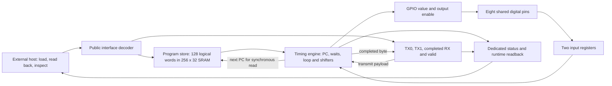

# Architecture of the submission candidate

The production design is a small programmable timing engine. Programs combine
GPIO updates, counted delays, bounded input waits, loops and byte shifting to
implement UART, SPI and I2C on the same hardware. Protocol framing and cleanup
live in programs; there are no dedicated UART, SPI or I2C controllers.

The supported target is **od128-sram-v1**, public interface **0x22**. It exposes
128 logical 32-bit instruction words, two transmit bytes and one completed
receive byte. The implementation uses one 256-by-32 IHP SRAM macro and 353
register bits outside that macro. The physical allocation is 8x4 CMOS5L with a
20 ns clock target. These dimensions and counts are not a claim that the design
is the smallest possible implementation.

The diagram shows logical data paths. The decoder also owns the shared pins
during loading. Every sequential block, including the SRAM, uses the external
clock; the design does not create an internal clock.

## Execution and storage

An instruction acts on an accepted rising edge: reset is released, the program
is ready, loader mode is off and enable is asserted. The engine has RUN,
WAITING, HALTED and FAULTED states. A 16-bit countdown expresses delays; a
single bounded loop repeats 1..31 words up to 255 times. Separate drive/sample
operations let firmware place serial data and sample it on different edges.
The [ISA guide](isa.md) gives encodings, timing and invalid sequences.

SRAM reads are synchronous. The engine's combinational next-PC calculation
supplies the address for the next fetch, and a fetch-address tag checks that
the returned word belongs to the current PC. A 32-bit word-zero shadow permits
the first instruction to execute immediately after the documented loading and
flush sequence. It also handles a return to PC zero without a new startup
latency. This preserves the established program schedules while changing the
storage technology.

The SRAM itself has no data reset. Sampled chip reset clears a 128-bit logical
validity mask and the word-zero shadow. Unwritten words read as zero. The first
byte write to a word initializes its other lanes to zero; subsequent writes
update only the selected lane. A valid length commit **does not check that all
bytes were supplied**. The host must write and verify every intended byte;
otherwise a zero or partial instruction can still execute. The assembler's
loading plan performs that verification.

## Public interface and ownership

The eight dedicated input pins select loading or runtime readback. The eight
dedicated outputs normally report state, program-ready and the low five PC
bits. Runtime selectors expose the complete PC, interface identity and data
registers without changing GPIO ownership. The eight bidirectional pins carry
loader bytes during loading and protocol signals during execution.

Program banks select eight-word groups, numbered 0..15. A bank selection or a
program-byte write invalidates ready; committing a length of 1..128 restores
ready and bank zero. Program-byte readback requires a rising edge and works
with either enable value. Data/control reads are combinational. Writes require
reset released and enable high. See [the loading procedure](programming.md)
and [Tiny Tapeout datasheet](info.md).

Entering loader mode resets the engine on a rising edge, including its GPIO
state, but does not by itself erase stored programs, payloads or completed
receive data. Loader reads drive all eight shared pins; loader writes release
them. The external host and protocol target must respect that ownership.
Sampled chip reset releases the engine's runtime GPIO, invalidates the image
and clears payload/result state. Loader-mode output ownership still follows
the public decoder. Reset or board power-down requires a new load sequence.

With reset released, enable low freezes engine progress and runtime GPIO.
The input synchronizer and SRAM read path continue clocking. HALT and FAULT
retain the current GPIO value and direction; they do not automatically produce
a STOP, idle level or bus release. Firmware must arrange its terminal outputs
and bounded failure cleanup explicitly.

## Input and result timing

The engine consumes the output of two input registers. In the digital model,
the value consumed on execution edge n was sampled from the pins at n-2.
An external change strictly after edge B first affects execution at B+3.
The two disabled flush edges after loading establish known idle inputs. This
models digital transport latency, not metastability probability or analog
setup/hold margins.

Each completed eight-bit shift overwrites one RX register and sets raw-valid.
Raw-valid remains set until chip reset or a TX payload write; a new byte need
not produce another valid transition. It does not certify framing, ACK status,
successful termination or lossless delivery. The bounded UART host protocol
caches tentative data and accepts it only after the required final checks.

## Measured architectural decisions

The register-backed store became the dominant physical cost. In the matched
[E0042 mapping experiment](../evidence/E0042-sram-prefetch-screen/README.md),
replacing it with synchronous SRAM and prefetch produced these measurements:

| Mapped measurement | D39 register store | SRAM candidate |
|---|---:|---:|
| Flip-flops outside SRAM | 4,278 | 353 |
| Standard-cell area, square micrometres | 477,788.2578 | 53,089.7598 |
| SRAM footprint, square micrometres | 0 | 49,488.4992 |
| Combined mapped footprint, square micrometres | 477,788.2578 | 102,578.2590 |

The combined mapped footprint fell 78.5306% under those matched conditions.
The macro's full 8,192 physical bits are counted even though firmware exposes
only 4,096 program bits. Mapping did not establish physical feasibility by
itself. [G2's later qualification](../evidence/E0045-g2-sram-qualification/README.md)
passed the complete routed, electrical, precheck and public-netlist gates after
explicit SRAM power, input-buffer, pin and checker integration work. Its routed
standard-cell area is 61,294.1 square micrometres, separate from the macro.

Earlier [G1's P/compact10 comparison](../evidence/E0031-8x4-physical-comparison/README.md)
rejected P despite its lower routed standard-cell area because it violated a
fanout limit. Register-store placement/routing failures also remain retained.
The design choice follows complete acceptance, not the best isolated count.

## Demonstrated workloads and limits

The [thirteen programs](../programs/od128-sram-v1/README.md) cover two UART 8N1
TX frames, bounded two-frame RX, all four SPI modes in both bit orders, and
I2C write/read/repeated-START transactions. At the 50 MHz target, the examples
use UART period 434 edges, SPI half-period 25 edges and the frozen digital
Standard-mode I2C contract. These are program schedules, not measured Fmax.

UART RX needs the documented framing, clock-ratio and bounded host service;
terminal-only reads recover only the last byte. SPI requires the declared
MISO hold interval. I2C requires external pull-ups, resolved bus feedback and
bounded stretching/cleanup; arbitration, unrestricted transactions and analog
compliance are outside the demonstrated scope. Shared pins require target
isolation during loader reads and suitable external voltage interfacing.

[Verification](verification.md) separates simulation, scoped formal results,
routed timing and reproduction. G4's new official runs and final release are
tracked in [E0047](../evidence/E0047-g4-submission-candidate/README.md); their
results must be read there rather than inferred from the G2 measurements.
No fabricated-chip, FPGA or owner-fluency completion result is claimed.
