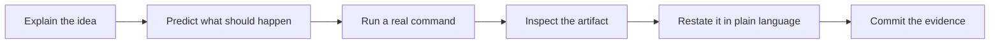

# Project goal

This project has two long-term outcomes. Engineering has priority until the
owner explicitly asks to resume the learning work. [D52](decisions/0052-engineering-first-powered-loader.md)

1. Produce a credible, open-source, reprogrammable protocol-emulator ASIC.
2. Make Khangelani capable of understanding, operating, questioning and
   defending the work without depending on unexplained expert judgement.

The technical research question remains:

> What is the smallest computational substrate that can efficiently express
> useful digital communication protocols under hard temporal constraints?

When the owner resumes learning, its question is:

> Can every design claim be connected to a source file, an executable command,
> an inspectable result, and a clear explanation of what was and was not proved?

The ordered milestones, completion checks and planning targets are in
[goals to submission readiness](goals.md). G1 through G5 are complete. The
first deferred learning checkpoint is G6's M0 teach-back under D8. The
[technical review council](reports/2026-11-24-technical-review-council.md)
prioritized the continuously selected cold-start host transport. Its digital
qualification is complete in [E0050](../evidence/E0050-powered-cold-loader/README.md).
Next come a calibrated physical measurement when equipped and the competition filing.

## Working contract

Engineering follows the evidence loop in [AGENTS.md](../AGENTS.md). Use the
following learning loop when the owner resumes G6.

- Introduce terminology only when it helps describe something concrete.
- Connect each concept to a repository file, command and visible result.
- Recommend a default before presenting unfamiliar alternatives.
- Distinguish verified facts, hypotheses, decisions, failures and open questions.
- Treat missing evidence as `NOT_EVALUATED`, never as an implied pass.
- Preserve failed experiments when they affect the next decision.
- Review technical evidence at each milestone. Resume owner checkpoints upon explicit request.
- Keep learning progress conservative: automation can validate the record and
  resources, but only an owner explanation and follow-up reasoning can satisfy
  a fluency criterion.

The aim is not command memorisation. Fluency means being able to reconstruct
the workflow, interrogate its evidence, make a bounded change, and explain why
the resulting claim is justified.
