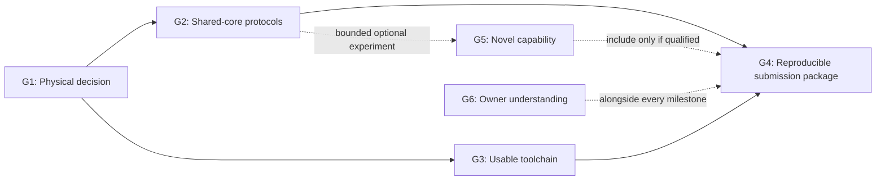

# Goals to submission readiness

Updated: 2026-11-12. Decision: [D32](decisions/0032-goals-to-submission-readiness.md).
The equal engineering and owner-learning outcomes remain in [the project goal](goal.md).

Build a useful, reprogrammable chip with evidence another person can reproduce.
The immediate bottleneck is physical feasibility and shared-core protocol coverage.
Further instruction compression is valuable only when it improves that outcome.

## Priorities and planning targets

Dates below are internal planning targets, not measured completion promises.
The external deadline is 2027-01-18; aim to have the submission package ready on
2027-01-11, leaving a week for corrections.

| Goal | Outcome | State | Target | Existing work |
|---|---|---|---|---|
| G1 | Qualify the current physical setup and decide whether timed GPIO P is worth adopting | **COMPLETE 2026-11-12** | 2026-11-20 | M3-T01, M3-T02, M5-T01 |
| G2 | Demonstrate UART, four-mode SPI and I2C through programs on one core | **ACTIVE**; od128 functional/formal gates pass, physical gate open | 2026-12-11 | M1-T03, M2-T01, M3-T01 |
| G3 | Make programs easy to assemble, load, inspect and reproduce | QUEUED; develop with G2 after the instruction decision | 2026-12-18 | M4-T01 |
| G4 | Deliver a reproducible final chip release and submission package | QUEUED; physical checks start in G1 and repeat after material changes | Candidate freeze 2027-01-04; package 2027-01-11 | M5-T01 |
| G5 | Demonstrate one useful capability beyond the initial protocol set | CONDITIONAL experiment, after G2 | Decide by 2026-12-18 | M3-T02 |
| G6 | Make the design and its limits explainable by the owner | PARALLEL; M0 teach-back PENDING | At each milestone | M0-T01 and later learning gates |

## G1 - Establish physical feasibility before more optimization

The official November 9 update confirms 8x4 tiles. D33 updates the checked-in
configuration and freezes the [comparison](specs/g1-cmos5l-physical-comparison.md);
D34 adds a shared correction for the measured fanout violations. D35/E0031
qualifies compact10's experimental physical pilot and rejects P's remaining
fanout failure. Historical evidence retains 6x4.
See [S1](sources.md) for the rule observation. Configuration is not qualification.

Completion checks:

- [x] Record a reviewed 8x4 configuration and immutable CMOS5L flow inputs;
  update metadata, configuration, checks and the evaluation contract together.
  Preserve the archived 6x4 source identities and results.
- [x] Compare the complete P and compact10 chips with the same library, corner,
  flow, pin assumptions and 50 MHz target. Include their real loader, stores
  and support logic; retain each variant's actual capacity.
- [x] Record mapped area, timing, storage cost and functional/formal compatibility.
  Run an official routed pilot of the selected candidate with precheck and
  appropriate gate-level public-pin tests. Report setup/hold, physical checks
  and utilization; unresolved failures remain failures.
- [x] Publish a supported adopt/reject/revise decision with source hashes and
  retained artifacts. A mapped saving alone is not a routed saving; route both
  variants before claiming a routed cost comparison.

A negative result still resolves the P decision, but physical feasibility stays
open until a candidate passes its gate. If P loses its advantage, retain the
simpler viable alternative. Revisit clock or capacity through a documented,
matched comparison instead of silently relaxing a failing condition.

**Completed 2026-11-12.** D35 selects compact10's qualified experimental pilot
and rejects P under the frozen D34 flow. Both candidates were routed with
matched conditions; their costs, capacities, compatibility and failures remain
in E0031. Compact10 passes every required routed metric, ten official prechecks
and twelve public netlist groups with 1,052 unchanged SPI records.

[Alpha.5](https://github.com/KG-khangelani/protocol-emulator-asic/releases/tag/v0.1.0-alpha.5)
publishes D35 and the original archives. All 28 release assets were downloaded
anonymously and verified, including nine original physical archives and the
curated evidence snapshot. The matching image/source identity and public
access pass; all six tag workflows pass.
[Publication verification](../evidence/E0031-8x4-physical-comparison/release-verification.json)
and the [completion audit](../evidence/E0031-8x4-physical-comparison/completion-audit.json)
record the evidence. The next engineering goal is G2; further P tuning remains deferred.

## G2 - Prove useful protocols on the same programmable machine

Activated by the owner on 2026-11-12. Commit and push cohesive verified steps
to main as work progresses. This goal includes combined protocol regression and
fresh physical qualification before production promotion; a contract or oracle
alone does not complete it.

The [frozen I2C contract](specs/p-i2c-controller-100k.md) and D36/E0032 independent
oracle pass 19 groups with 3,902 reference/control observations. This includes
all bytes, ordinary addresses, stretching, final-edge priority and bounded
cleanup. It qualifies no RTL; compact10 remains the integration baseline.

E0033 measures ten identical public records per simulator on unchanged compact10:
bounded inline cleanup fits ten words, waits inside LOOP retain held-SDA faults,
and a literal write-wire list needs 122 words against a real ten-word store.
These are scoped kernels and a capacity screen, not complete I2C transactions.

E0034 confirms nine-word existing SHIFT_STEP receive reuse, with 268 identical
records per simulator (all bytes, eight stretch positions, four negatives).
The measured 98,619.329 Hz kernel has no full I2C framing/cleanup qualification.

D37/E0035 advances experimental od128: 96 words for combined write/read versus
211 literal words, with actual 128/255-word stores. Both simulators agree on
1,160 od128 I2C records and the twelve existing public kernel/UART/SPI groups;
all 1,052 SPI records match compact10. Current boundaries, scoped instruction
proofs and cleanup equivalence pass. The initial whole-memory induction
timeouts remain inconclusive. E0036 closes the 31ebf82 CI audit with all three G2 jobs and
verified archive/source identities; both candidates pass the full I2C matrix
in both simulators. Its complete partitioned store proofs now pass every word's
transition/read relation and common controls (652/1,287 assertions), with
checked reset-reachable mutations. The exact eighteen-group selection passes
both simulators at e2ff52e. literal255 fails fixed-footprint placement at
111.564% adjusted utilization. od128 maps to 39,806 cells / 564,744.3984 square
micrometres, then fails global routing with GRT-0228 congestion; dependent
precheck/netlist jobs are skipped. E0036 retains the verified failure.
All five d3c340f CI gates and their downloaded artifacts are now audited,
including a complete 100-task store run with both variants and checked controls.

**Next executable action:** diagnose D39's retained routing failure and screen
a structured banked read network. Finish the source-matched production
verification profile using the retained integration probe and specification.
Keep the same capacity, interface, protocol programs and pinned 8x4 conditions;
generic savings are not physical results. Preserve G1's pilot, the original
od128 routing failure and literal capacity rejection. Integration and
publication remain required.

D38/E0037 now qualifies that rewrite locally: all 652 store assertions,
checked controls and both simulators' eighteen public groups pass; all required
reference records are identical. The retained evidence replay and physical
staging preflight pass. All seven e5eef5b CI jobs pass and both new-candidate
archives are audited. Physical run43241097269 at 869ee34 fails global routing
with GRT-0228 congestion. Its 40,242 mapped cells / 561,244.4208 square
micrometres save only 0.620% mapped area versus original od128; precheck and
netlist jobs are skipped. E0037 retains the verified failure. A separate shared-read screen saves 37.64%
generic cells from D38 with reset-reachable complete-chip equivalence, but
the physical gate remains. D39/E0038 reproduces that source; fresh whole-chip
proof/reset and all three read-path mutation controls pass in both simulators.
Both simulators pass all eighteen public groups with identical reference
records; retained replay, ten audit-corruption controls and staging preflight
pass. All nine b774915 CI jobs pass and both new-candidate ZIPs are audited.
Physical run43249867361 at 426cea1 maps to 34,683 cells / 477,788.2578 square
micrometres, 15.3974% below original od128, but fails GRT-0228 global routing.
The original archives, runtime/source/fixed-condition audit and failure are
retained in E0038. Dependent precheck/netlist jobs are skipped. The isolated
default-integration probe exposes four obsolete test expectations; those must
be handled explicitly before production promotion and publication.

D40/E0039 now handles those expectations through an explicit source profile:
30 groups pass in each simulator, while all 22 original groups still pass on
the historical source. Initial current and complete historical formal runs
pass. The later normal-command temporal proof reaches its 300-second wall
limit; seven other stages pass, with no aggregate PASS. The 1,717-file replay
preserves this distinction. A reproduced metadata-cache omission is fixed by
running repository checks fresh; all 114 checks pass. Complete current-command
CI and a physically successful implementation remain open.

Completion checks:

- [x] Freeze the I2C controller contract and independent oracle before extending
  the ISA. Cover 100 kHz operation, 7-bit addressing, write/read, repeated START,
  ACK/NACK, open-drain release, clock stretching and bounded timeout.
- [x] Pass the [mandatory workload matrix](research/evaluation-contract.md) on
  one candidate revision: pin traces, input wait, shifting, bounded loops,
  public-pin reload, UART TX/RX, four-mode SPI and I2C.
- [x] Retain UART framing/phase/error and host-service boundaries. State which
  received bytes are available and when; continuous autonomous delivery remains
  unqualified until separately implemented and tested.
- [x] Check both SPI bit orders and all four modes with explicit input timing
  assumptions. Preserve held-response successes and edge-only negative controls.
  Do not advertise broad SPI compatibility from a narrower input contract.
- [x] Load the different protocol programs through public pins without changing
  the RTL. Pass both simulators, relevant formal properties and meaningful
  wrong-program/adversarial-input controls; retain seeds and counterexamples.
- [ ] Promote the chosen candidate only with the combined regression and fresh
  physical evidence for that revision. Earlier isolated or M0 results do not
  qualify the promoted chip.

The checked functional/formal requirements above refer to the exact E0035
od128 source hashes, with E0036's clean combined audit and the stated protocol
limits. The final production-promotion check remains open and G2 stays active.

A protocol that needs a new dedicated RTL path falsifies the current flexibility
hypothesis. First test whether a general instruction or a stated scope change
resolves it, with a measured cost and an explicit decision.

## G3 - Make the chip practical to program

Completion checks:

- [ ] Provide a small assembler with readable instructions, symbols, capacity
  checks, deterministic encoding and useful invalid-program diagnostics.
- [ ] Emit a cycle/schedule listing that makes timing assumptions inspectable.
- [ ] Provide documented load, readback and run steps, plus versioned UART, SPI
  and I2C examples for the selected ISA.
- [ ] From a clean clone, build the examples and reproduce their public-pin
  traces using the pinned workbench and the independent oracle.

Start with an assembler. Build a larger temporal IR/compiler only if a concrete
programming problem justifies it. Compatibility changes need an ISA version and
migration note, not silently changed example bytes.

## G4 - Close and publish the final design

Completion checks:

- [ ] Freeze a candidate by January 4 and run the official 8x4 CMOS5L GDS flow,
  timing checks, precheck and real netlist simulation for the final core.
  Gate-level tests must exercise the actual public loading/protocol paths.
- [ ] Reproduce the result from a clean checkout with pinned tools. Retain source
  revisions, commands, timing/area reports, checksums and relevant failures.
- [ ] Publish the final verified release and matching workbench package; verify
  download checksums, image/source identity and public access. Update research
  releases after qualified milestones; a planning-only change needs no release.
- [ ] Prepare a readable architecture/ISA guide, examples, verification and
  AI-use account, measured tradeoffs, external host/electrical assumptions and
  unresolved limitations. Every positive claim points to evidence.
- [ ] Recheck submission rules and assemble the ready-to-submit repository link
  and supporting material by January 11.

This goal ends at submission readiness. Actual competition submission, hardware
spending and fabricated-silicon results remain separate owner decisions.
If a required gate is still failing, report that gap and revise scope explicitly.

## G5 - Reserve a bounded opportunity for a useful breakthrough

Default experiment: use firmware alone to replay an irregular digital waveform
or inject a controlled timing fault. This tests whether the same substrate is
useful beyond the protocols used to design it.

- [ ] Before running, choose one use case, a control program, expected pin trace,
  measurement and a two-working-day total investigation budget.
- [ ] Demonstrate it through public-pin-loaded programs with zero new RTL, an
  independent trace check, and explicit timing/input limits.
- [ ] Keep a successful example and explain its value; retain a failed result
  and stop if the budget expires or mandatory closure slips.

Only start after G2 passes. Decide by December 18; defer if prerequisites are
late. This experiment is optional and does not delay G4. Storage macros or a
different substrate become candidates only if measured area/timing identifies
the corresponding bottleneck. USB/Ethernet, extra engines and further packing
are deferred unless new evidence materially changes the plan.

## G6 - Build independent understanding alongside the chip

At each milestone, use the [learning loop](goal.md) and record only demonstrated
fluency:

- [ ] The owner can trace a program from source to pin events and distinguish a
  simulation result, a formal claim, mapped area and routed timing.
- [ ] The owner can rerun one relevant check, predict a small change, inspect the
  outcome and explain a retained failure or assumption.
- [ ] The owner can explain the chosen architecture, the rejected alternative,
  its limits and the final release's provenance in plain language.

Automation may prepare lessons and validate records. Only the owner's
explanation and follow-up reasoning can satisfy these checks. Pending fluency
does not stop engineering under [D8](decisions/0008-decouple-engineering-learning.md).

## Keeping the goals honest

Keep one active engineering goal. Within it, use one bounded experiment with a
question, frozen conditions, success/failure criteria and retained artifacts.
After each milestone or a material failure, update this file, [state](state.md),
the [backlog](backlog.md) and the [research ledger](research-ledger.md).
Reassess dates and priority when evidence changes; do not convert a missed gate
into a pass. This plan itself supplies no new hardware qualification.
