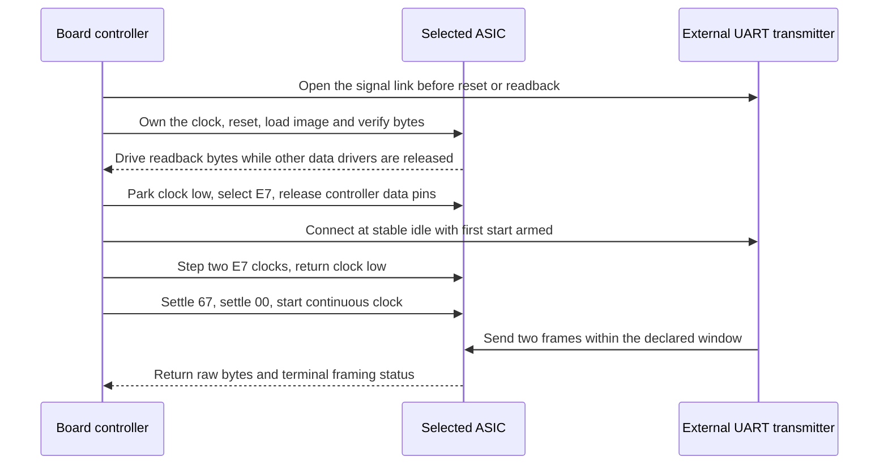

# Experiments that can change the next decision

The estimates below are planning estimates for an engineer already familiar with the repository. Existing CI times are elapsed machine time. Equipment and human availability were unknown. Start each experiment with a fresh H: directory, dated stimulus, expected observations and time cap. Preserve the first failing case. These are proposed experiments. E0049 records the work already executed.

## 1. Deliver a usable cold-start transport

**Hypothesis.** A controller that can park and step the project clock, leave the project selected and isolate an external peer can load any released image without advancing the program early or briefly enabling two drivers.

**Work.** One software/embedded engineer, 4–8 hours for a selectable transport and instrumented digital backend. Consume the versioned binary and byte/readback plan produced by `tools/assembler.py::load_plan`. Pin the source/image identity. Make controller operations explicit for ownership, direction, clock, selector and data. The released macro-port plan and its software customers already exist. Start with cold load, which does not need evidence of prior exclusive custody. The source-linked ETR qualification card explains the external idle-high UART hazard. [What the existing commands do](../../../evidence/E0049-review-council/panel-c/delivery-delta.md) · [ETR connection and sequencing](../../../evidence/E0049-review-council/panel-b/etr-fixture.md)

**Score.** From cold selection/reset verify each occupied byte and expected reply with the controller/peer interlock. Hold enable high at every sampled rising edge. With independent clocks disabled, park the clock low, issue the two reserved-selector clocks at `E7`, clear only bit 7 to `67`, settle, then select `00` before running. The released host's existing terminal and valid rules still apply. Compare the product transport's emitted observations to the established 55 G3 and twenty applicable G5 records. The 1,160 I²C archive supplies a regression reference if the runtime sequencer changes. Inject a wrong readback, an unisolated idle-high peer, an early restart and an unordered selector transition. Accept a digital transport only if all required records match and each mutation is caught before a falsely accepted run. A backend lacking a required control has an unsupported operating condition. A physical claim additionally requires measured cold start, direction and turnaround on the named fixture. [Powered comparison](../../../evidence/E0049-review-council/powered-netlist/README.md) · [Selector orders](../../../evidence/E0049-review-council/panel-c/records/selector-orders.json)

## 2. Observe the owner and a first-time reader

**Owner.** Allow 30–45 minutes with the owner for the existing M0 checkpoint. Start with `.\tools\workbench.ps1 LearnM0` and `LearnWaveform`. Ask the owner to predict a row before viewing it and use the RTL, timing and precheck evidence to defend the answer under a new follow-up. Record only demonstrated criteria and level of support. Close G6 milestones only under the existing rubric. A correct automated transcript and a successful novice trial cannot supply the owner's explanation. [Learning checkpoints](../../learning/checkpoints.md) · [Current criterion record](../../learning/progress.json)

**Usability.** Two unfamiliar readers separately choose the physical release and the waveform starter from the public entry point. From a clean directory each obtains a program, predicts an interval change, edits source, rebuilds, reads the output and observes a deliberately wrong expectation being rejected. For a VM/PIO comparison use equivalently prepared environments, counterbalance order and pretest two comparable edits. Cap at 30 minutes per edit, approximately 1–2 staff-hours per participant. Log correct artifact selection, completion without hints, interpretation, actual minutes, download/setup minutes and interventions. A recurring failure identifies the first specific correction to test with a new reader. If both readers complete the task, retain the existing guide. Two readers can reveal a problem but cannot estimate a user-population success rate. [Common edit and human-trial design](../../../evidence/E0049-review-council/panel-c/owner-comparison.md)

## 3. Measure one claimed external interface

**Hypothesis.** A named driver, peer and electrical load satisfy the firmware's edge and ownership assumptions at the receiving pin. Choose the interface the operator actually needs. A powered ETR study can use the published carrier routing; a pre-silicon FPGA fixture can exercise digital logic and instrumentation. The final die, mux and package require their own capture.

**Resources and controls.** With the equipment in hand, allow 2–4 engineer-hours to calibrate, 3–6 hours for the first SPI ownership campaign, another equipped day for I²C or 1-Wire. If an equivalent FPGA wrapper is missing, budget another 0.5–2 engineer-days. Record the exact board, target, supply, pull-ups, wiring, probe loading, timing uncertainty and sample count. Use known driven and released states in both directions and observe the bus at both ends. Calibrate a current-sensitive witness because equal push-pull outputs can conceal opposing ownership in a logic trace. Remove the deliberately opposing measurement bias for normal decoding. At 60 pF per node the illustrative fixture itself can take 214.5 ns to indicate release after an instantaneous disconnection. Treat any interval straddling the acceptance bound as inconclusive. [Fixture, thresholds and safe controls](../../../evidence/E0049-review-council/panel-b/fixture/bench.md) · [Sensitivity and digital replays](../../../evidence/E0049-review-council/panel-b/fixture/README.md)

On a stock ETR carrier, J15 supplies a resolved voltage. The RP2350 direction register records a command and the external isolation control needs its own observation point. Infer target release within a declared strong-drive threshold using the calibrated target-branch measurement. The ASIC's internal output enable is directly observable in the model or an instrumented FPGA, but is absent from the stock connector. With only firmware logs and a single resolved logic trace, report signal order and returned data. [Post-ballot observability check](../../../evidence/E0049-review-council/panel-b/post-ballot.md)

| Selected claim | Measurement and verdict |
| --- | --- |
| Powered UART | Peer physically isolated through readback, valid first start in the qualified arming window, receiver clock continuous and host captures both different bytes. Determine worst service interval on the controller. At exact P=434 use the existing 4,340-clock combined service limit. If claiming +2% transmitter baud under the council's assumptions require at most 4,254 clocks. Reject on contention, missed start, duplicate/missing byte or violated bound. |
| I²C at a named load | First run the released 96-word combined transaction. Measure SCL and SDA at the receiver around every required data/ACK change, checking the 0.3/0.7 VDD crossing order, Standard-mode rise/fall, high/low dwell, setup and data-valid limits. If a crossing fails beyond measurement uncertainty, compare the 108-word compensated guard with identical load, peer and stimulus. Promote it only if it repairs every relevant measurement and preserves digital behavior. |
| 1-Wire power query | Known local- and parasite-powered DS18B20s in separate runs, then no device and stuck/late controls. Independently count all seventeen remote slot starts and decode both command bytes plus power result. Sweep the declared load and target timing. A missing start or wrong power classification rejects that envelope even when HALT and the marker look correct. |

## 4. Compare architectures on an externally clocked target

**Hypothesis.** A programmable alternative or bounded firmware change can release a shared pin on an asynchronous abort and serve a fresh command without host service. The panel's synthetic 160 ns handoff is a research discriminator; obtain a named application's real requirement before proposing hardware adoption.

**Work.** Allow one architecture engineer-day for the first matched attempt. Reuse the prospectively defined mode-0 `A4 → 3C`, `A5 → A7` requester, 254 invalid commands, 0.5/1/2 MHz cases, four phases, unequal periods and saturated reply bits. Compare the original VM image, a bounded revised program and a one-SM PIO target; charge every extra SM, pin, FIFO, external switch, native peripheral, service call and restart. Use a common independent requester, externally scheduled SCK/CS, and observe both MISO direction and the resolved bus. Include the quiet command phase, ≥60 ns setup, ≥40 ns hold, missing edge, stuck/early/normal deselection and the next frame. Report cold setup, rearm commands, RAM/ROM, PC/IRQ/FIFO semantics, completed bytes and the first violating edge. [Full target contract](../../../evidence/E0049-review-council/panel-c/spi-target/spi-target-contract.md)

**Score.** After CS rises during a driven reply with SCK stopped, MISO must release within 160 ns. In the independent reselect case return SCK low at +80 ns, reassert CS at +160 ns and perform a complete fresh command after the specified setup. Require no command-phase drive and a correct new reply with no intervening host rescue. Preserve the observed 1,563 ns counterexample as a negative control. A circuit which disconnects MISO during CS high still has to pass the next transaction. Stop after one day if the complete role cannot be met within declared resources. Mark separately any smaller property reached by then. No silicon-area comparison follows from RP2040 program bytes. [VM target and timeout sweep](../../../evidence/E0049-review-council/panel-c/spi-target/README.md) · [External-gate counterexamples](../../../evidence/E0049-review-council/panel-b/fixture/formal-rebuttal.md)

Begin the PIO attempt with the already exercised one-bit echo for a stopped-low clock. Its 480-sequence grid includes 160 ns equality under the after-edge convention. It took 700/718 ns to release in two stopped-high cases. The first tests for a **complete** implementation should stall high and low at every driven response bit, try both data values, and serve the opposite command immediately afterward. Budget synchronizer, mapping, board and uncertainty margins separately from the emulator's cycle count. [Partial native-PIO screen and retained failures](../../../evidence/E0049-review-council/panel-a/pio-target/README.md)

## 5. Reopen a hardware choice only at a measured boundary

| Trigger and hypothesis | Resources and acceptance |
| --- | --- |
| A caller needs autonomous UART delivery beyond the measured host response. A second byte with explicit valid/error state could remove the first-result overwrite within a two-frame batch. | 0.5–1 engineer-day to model queue ownership, two- and three-frame overflow policy, abort quarantine and arbitrary data over phases/rate offsets. Charge at least eight information bits to retain an arbitrary independent byte and any required framing tags and control. Reject on duplicate delivery, silently lost data, premature commit or incompatibility without a versioned profile. A bound for two frames gives no unbounded-stream guarantee. |
| A specified tile, power or routability constraint makes a 2,130 µm² nominal mapped reduction consequential, or the foundry/flow supplies a new limit. | Reproduce the affected STA/geometry calculation first. If it changes qualification, budget a paired physical pilot including full loader, macro, clock tree and wrappers, both full software contracts, energy for a named workload, official precheck and netlist tests. Prior G4 critical paths were 5,899 and 5,679 seconds per build; pair runner use was about 203.4 minutes. Budget engineering time separately, tentatively 1–2 days for a clean comparison plus queue/flow recovery. Reject any candidate with failed physical checks, incompatible required applications or no benefit against the named threshold. [Mapped burst trade](../../../evidence/E0049-review-council/uart-ablation/README.md) · [Measured sensitivity](../../../evidence/E0049-review-council/panel-b/signoff-rebuttal.md) · [CI job durations](../../../evidence/E0049-review-council/panel-c/records/delivery-metrics.json) |

Before the project's 11 January 2027 package checkpoint, compare the organizer's then-current form and rules with the [submission packet](../../submission.md). The published deadline is 18 January. A changed requirement takes precedence over the discretionary experiments. [Competition announcement and FAQ](https://blog.janestreet.com/protocol-emulator-asic-competition/)
