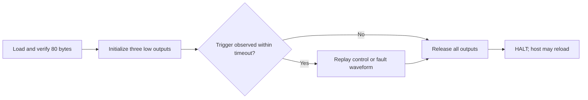

# Reproduce a digital timing fault with two small programs

The G5 example uses the same qualified chip as a triggered source of digital
stimulus. A host loads one program, verifies the bytes, then lets the chip
maintain the spacing between output changes. Reloading a second program moves
one selected edge. This is useful for checking how other digital logic reacts
to relative timing, without adding a fixed protocol engine or making the host
toggle every edge itself.

The [control program](../experiments/waveform_replay/control.asm) and
[fault program](../experiments/waveform_replay/timing_fault.asm) each occupy
20 of 128 logical words: 80 bytes. They use SET, WAIT, WAIT_PIN and HALT.
Only two WAIT words differ: delay the selected rising edge by two clocks,
then shorten the following wait by two clocks. Every later output transition
and the final release stay at the same position.

## Connect and run

`uio[7]` is the trigger input. The three stimulus outputs are `uio[2:0]`;
pins 3 through 7 stay inputs during execution. The host and external fixture
must follow the [public loading and readback procedure](programming.md) and
[electrical requirements](submission.md#external-host-and-electrical-requirements).
External devices release the shared bus during loader reads and never drive
the three stimulus outputs while the program owns them. No physical fixture
or attached peripheral has been tested by this experiment.

Build each image with Python 3.11 or later, using a new output directory:

```powershell
python tools/assembler.py experiments/waveform_replay/control.asm --out build/my-control
python tools/assembler.py experiments/waveform_replay/timing_fault.asm --out build/my-fault
```

Each build contains an 80-byte binary, decoded JSON, a timing listing and a
public load/readback plan. Read back every byte before committing the 20-word
length. After loading, supply the idle trigger level for two disabled clock
edges, then enable execution. A high trigger already present at that point is
accepted: WAIT_PIN tests a level, not a fresh rising edge.



## Read the timing

Edges below are relative to the first stimulus SET, after trigger acceptance.
Output bytes describe all eight pins; the output-enable byte is 7 until
release, so only pins 0, 1 and 2 are driven.

| Relative edge | Control output | Fault output | Meaning |
|---|---|---|---|
| 0 | 1 | 1 | Pin 0 rises |
| 3 | 3 | 3 | Pin 1 rises |
| 8 | 2 | 2 | Pin 0 falls |
| 13 | 6 | 6 | Pin 2 rises |
| 20 | 7 | 6 | Selected pin 0 rise occurs only in the control |
| 22 | 7 | 7 | Delayed pin 0 rise occurs in the fault |
| 29 | 3 | 3 | Pin 2 falls at the original time |
| 37 | 1 | 1 | Pin 1 falls |
| 46 | 0 | 0 | Pin 0 falls |
| 52 | 0 | 0 | All outputs released |
| 53 | 0 | 0 | HALT |

At the assumed 50 MHz clock, two clocks correspond to 40 ns. This is a digital
schedule conversion; it does not measure pad delays, analog glitches or a
physical chip's maximum frequency. Keep enable high for the stated wall-clock
timing. Pausing enable stretches the waveform. The input synchronizer adds
latency, and arbitrary asynchronous pulses have no guaranteed capture.

In the normal simulated case the trigger is first sampled at runtime edge 8,
the waveform starts at 11, outputs release at 63 and HALT occurs at 64. The
last accepted trigger is first sampled at 32; a trigger arriving one edge later
is ignored by the timeout path. An absent trigger releases the outputs at 35
and halts at 36. Cleanup is an explicit SET: HALT by itself does not release
pins. Terminal public status is `0xB3` in both paths.

## Check the evidence

From a repository checkout inside the pinned workbench:

```sh
python3 experiments/waveform_replay/run.py --require-clean --out build/my-g5-run
```

The command loads through the public pins and checks every rising edge in both
simulators. The independent oracle uses the predeclared pin schedule, without
decoding program instructions. The 21 cases include trigger phases and timeout
boundaries, missing pin release, an uncompensated delay, an actual corrupted
load byte, recovery by reload and disabled-clock stretching. Five deliberately
invalid comparisons must be rejected. Each trace includes eight edges after
HALT to detect unwanted output activity.

[E0048](../evidence/E0048-waveform-replay/README.md) records the qualification
status, original traces, clean reproduction and retained failed attempts.
The [frozen contract](specs/g5-waveform-replay.md) states the exact assumptions
and bounded investigation. G4's hardware and physical evidence remain
unchanged; this example does not establish a new architecture, minimum code
size, analog fault injector, physical device result or owner teach-back.
