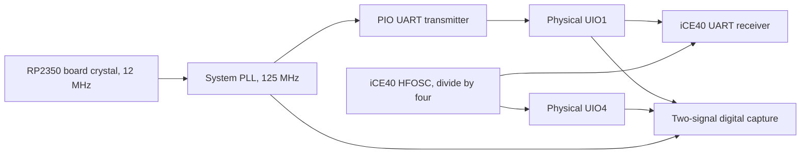

# UART on two remote boards with independent transmitter and receiver oscillators

**Both FabricFox boards received `55 AA` with a fixed transmitter preset before any rate adjustment.** The RP2350 transmitted on the physical UIO1 pin at a nominal 27,648.75 baud. The iCE40 receiver ran from its own HFOSC. Across the two boards and a fresh repeat on board 1, all **15 valid two-byte batches** delivered both intended bytes. All **six malformed batches** ended in a framing fault and delivered neither byte. The largest observed host-service bound was **216 µs**. The tightest conservative budget in the matrix was **353.648 µs**. [Predeclared criteria](../../docs/decisions/0056-test-uart-with-independent-oscillators.md) · [Offline audit](audit.py)

## What the boards measured

| Measurement | Board 1 | Board 4 | Board 1, fresh repeat |
|---|---:|---:|---:|
| Idle FPGA clock, MHz relative to the RP2350 clock | 11.988550 | 12.027596 | 11.981806 |
| Receiver clocks between frame starts on the fixed preset | 4,340 | 4,351 | 4,335 |
| Fixed preset baud offset measured during transmission | +0.0245% | −0.2427% | +0.1244% |
| One-time matched bit period in 125 MHz transmitter ticks | 4,525 | 4,510 | 4,528 |
| Fast setting, measured baud offset | +1.9939% | +2.0453% | +1.8474% |
| Slow setting, measured baud offset | −2.0478% | −2.0017% | −2.0137% |
| Largest host-service bound | 216 µs | 216 µs | 216 µs |

Each session began with an intentionally damaged second program byte. All three reads returned `01` instead of `00` at loader strobe 38. Each subsequent cold load verified all 32 original bytes, the eight-word length, both payload registers and identity `22`. The first batch used 4,521 transmitter ticks per bit on every board. Only after that batch did the host measure the idle receiver clock to choose a matched transmitter setting. The matched, fast and slow cases delivered `55 AA`. A second matched payload delivered `96 69`. A bad first or second stop yielded `E6` with no delivery, including discard of the tentative first byte on every second-stop fault. [Board 1 receipt](board-1/result.json.gz) · [Board 4 receipt](board-4/result.json.gz) · [Fresh board 1 receipt](board-1-repeat/result.json.gz)

The two primary sessions ran on 24 November 2026 at 22:48:01–22:48:37 UTC and 22:48:54–22:49:29 UTC. The repeat ran at 22:49:50–22:50:26 UTC. These were 25 November locally in South Africa. The public device identities matched the corresponding E0052 boards. Every completed session restored the original 133 MHz controller setting, released the host bidirectional outputs and restored the gallery selection that was active on entry.

## Evidence that the clocks were independent

The RP2350 clock-mux, PLL divider, lock and crystal-status registers were read before and after each two-frame trial. They selected the system PLL at 125 MHz. The carrier BOM identifies the 12 MHz crystal. The transmitting state machine advances on that clock and has no instruction that samples the FPGA clock. GPIO16 supplies a steady run enable throughout transmission. A separate monitor detected zero early falling edges and detected the deliberate fall at the end of every trial. [RP2350 carrier BOM](https://raw.githubusercontent.com/TinyTapeout/pcb-files/4d6aa7d91db2b9f4f0ac8b83af80e99ee1a25cc9/ETR/demoboard/v3p2/bom/ttdbv3-populated-bom.csv) · [Clock registers](https://github.com/raspberrypi/pico-sdk/blob/2.2.0/src/rp2350/hardware_regs/include/hardware/regs/clocks.h) · [PLL registers](https://github.com/raspberrypi/pico-sdk/blob/2.2.0/src/rp2350/hardware_regs/include/hardware/regs/pll.h) · [Peer and clock monitor](../../experiments/remote_uart/independent_peer.py)

The diagnostic FPGA image clocks **403 mapped flip-flop clock pins and four RAM read and four RAM write clock pins** directly from one always-enabled HFOSC output at its nominal 12 MHz setting. Two builds produced the same 104,090-byte image with SHA-256 `5ac62a8840a7b41af8436379398ff1fbd48e42849099b4fbedde1a765947fb6f`. The explicit 13.2 MHz routing constraint passed with a 14.229 MHz internal timing estimate. While GPIO16 was held low, the FPGA clock continued to appear at UIO4. The normal runs then captured UIO4 and UIO1 together throughout each two-frame batch. [Lattice oscillator guide](https://www.latticesemi.com/api/document/download?id=50670) · [Receiver wrapper](../../experiments/fpga_uart/independent_clock.v) · [First build](receiver-build-a.json) · [Second build](receiver-build-b.json) · [Routed timing](receiver-timing.json.gz)

The offline decoder checks every expected data transition and samples each UART data bit and stop at its center. It also checks uninterrupted receiver-clock edges, the number of those edges between identifiable frame starts, and the register-read deadline. It subtracts one full observed receiver-clock period and one capture interval from the frame-start spacing for the service budget. The host bound adds the greatest poll gap, greatest read sequence and 2 µs timer allowance. Across the three sessions the board retained **1,020,240 sample instants**, including the isolated idle calibrations. The 16 ns nominal sampling interval and all frequency estimates refer to the RP2350 timebase. [Board 1 raw captures](board-1/terminal.bin.gz) · [Board 4 raw captures](board-4/terminal.bin.gz) · [Repeat captures](board-1-repeat/terminal.bin.gz) · [Decoder and clock checks](../../experiments/remote_uart/oscillator_check.py)

## Earlier failures and claim limits

- The first router invocation inferred the HFOSC nameplate constraint of 12 MHz despite the global 13.2 MHz setting. Explicitly constraining the oscillator net applied the required 13.2 MHz screen. [Initial inferred constraint](initial-clock-screen.json) · [Final router log](receiver-route.log.gz)
- The first physical image placed the clock monitor on UIO2. The HAT joins it to UI2, and the SDK's contention check prevented the requested selector value. The corrected fixture uses UIO4 for the clock, retains the UART on UIO1 and checks that the RP2350 releases its linked UI1 driver. It stages load data and returns readback on dedicated pins. A subsequent pilot incorrectly encoded the initial identity selection and read zero. Both stopped before a UART verdict. [Wiring and change](wiring-correction.md) · [Identity failure](initial-selector/terminal.log)
- An intermediate fixture delivered the fixed-preset pair but returned `E0` at a later handoff. The final wrapper synchronizes the host transfer controls and reset and registers the selector in the receiver clock domain. Three fresh sessions then passed. The retained failing trace does not identify the exact internal edge that caused the earlier fault. [Partial physical receipt](initial-handoff/result.json.gz) · [Raw terminal](initial-handoff/terminal.bin.gz)
- These results cover the released receiver RTL and program on a bench-specific FPGA image. Temperature, supply, long-term oscillator drift, calibrated absolute frequency, pad-release current and ASIC silicon remain unmeasured. The earlier shared-clock runs established their reported digital observations. The documented HAT connections limit any inference about electrical ownership in those runs. [HAT wiring](https://docs.fpgas.online/en/latest/boards/tt-fpga/overview/pin-mapping.html) · [Calibrated handoff fixture](../E0049-review-council/panel-b/fixture/bench.md)

## Reproduction

From the repository root in the locked workbench, `python3 -B evidence/E0054-separate-oscillators/audit.py` replays all three raw terminals, validates the producing source and checks the retained failures. It rejects five altered records independently, covering loss of the receiver clock, a changed transmitter clock source, a falling run enable, a driven shared selector and an incorrect delivered byte. The live command is `python3 -B experiments/remote_uart/run.py --suite oscillator --board fpga-1 --out build/fresh-board-1`. Use an empty output name for each run. [PowerShell Docker commands](../../experiments/remote_uart/README.md#separate-transmitter-and-receiver-oscillators)

The locked workbench passed `make doctor` and `make check`, including 163 unit tests. An earlier check rejected a changing workspace while the bench documentation was being edited. The final check used stationary inputs. The E0052 and E0053 offline audits also passed. All twenty qualified physical inputs matched the v0.1.0 and v0.1.1 releases. [Tool identities](doctor.log.gz) · [Interrupted check](interrupted-check.json.gz) · [Final check](check.log.gz)
